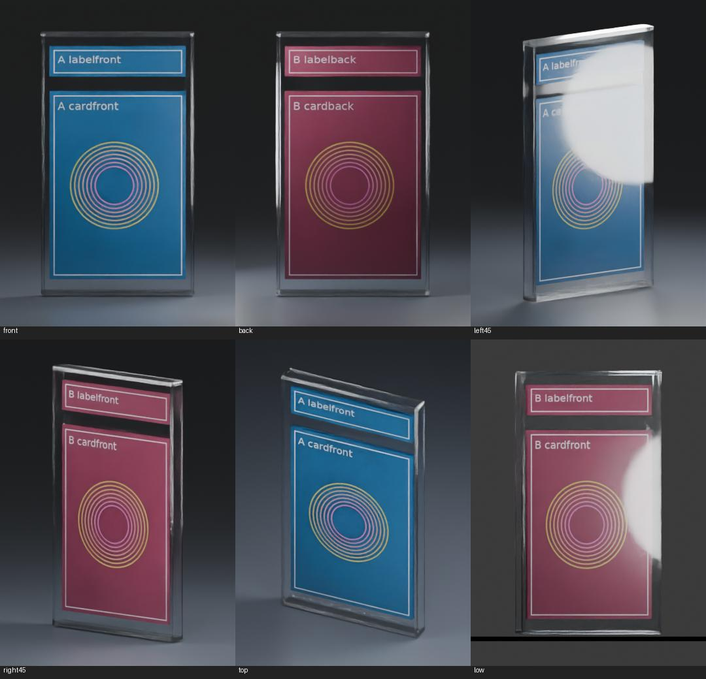

> **Proprietary - All Rights Reserved.** Licensed to Sandeep Grover. No reuse, copying, modification, or distribution without prior written permission. See LICENSE.

# Blender card-render batch demonstration

Original synthetic demonstration of CSV-driven image replacement and rendering. This is new implementation evidence, not a past client deployment or a complete product-rendering service. No client images, scenes, private proposal material or credentials are included.



## Demonstrated behavior

- Exact six-column CSV contract: output name, label-front, label-back, card-front, card-back, and preset.
- Asset-root confinement, unique safe output names, missing-image checks, six preset names, file hashes and rejection of existing output filenames.
- Separate generated CASE and LABEL scenes; append the Labels collection once and bind images to the actual active materials.
- Six camera views; preserve light transforms/energy and original source-file hashes.
- Per-render output checksums and timings. Batch execution uses two CPU threads; no GPU performance claim.

## Evidence and limits

12 standard-library unit tests passed. The actual integration run produced six 360×500 Cycles images in Blender 5.2.2 LTS; `verification.json` records measured render time and image hashes. Source scenes and lights stayed unchanged. Both front and back labels are upright.

These low-resolution images test binding and execution, not final product-render quality. The left45 and low views deliberately remain visible examples of reflections that need calibration against an approved reference. No holographic shader, color-accuracy validation, large-scale throughput or client-scene compatibility is claimed. The six demo presets change the camera while preserving one light rig; independent lighting presets would require integration work.

## Local execution recorded by the author

Execution requires the license holder's authorization; public visibility does not grant use rights. Python planning uses only the standard library. Scene construction/rendering require Blender 5.2.2 and its built-in `bpy`.

```sh
python3 -m unittest -v test_batch_plan.py
python3 main.py demo.csv --assets assets --out renders
blender -b --disable-autoexec -t 2 --python make_demo_scene.py -- demo_scene
blender -b demo_scene/CASE.blend --disable-autoexec -t 2 --python render_batch.py -- demo.csv assets renders demo_scene/LABEL.blend
```

The generator creates original sample scene files; the runner does not overwrite them. Use a fresh output directory for another run. This runner assumes the explicit object/material/camera contract documented in the source; arbitrary existing Blender files need a mapping audit first.

Official API references: https://docs.blender.org/api/5.2/bpy.ops.render.html and https://docs.blender.org/api/5.2/bpy.types.Image.html .
